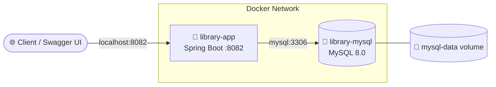

<div align="center">

# 📚 Library Management System

**A secure REST API for managing books, users and issue records, built with Spring Boot, JWT and Docker.**


[Quick Start](#-quick-start) •
[Features](#-features) •
[API Endpoints](#-api-endpoints) •
[Docker](#-docker-setup) •
[Roadmap](#-roadmap)

</div>

---

## 📑 Table of Contents

- [Features](#-features)
- [Tech Stack](#-tech-stack)
- [Quick Start](#-quick-start)
- [Authentication](#-authentication)
- [API Documentation (Swagger)](#-api-documentation-swagger)
- [API Endpoints](#-api-endpoints)
- [Docker Setup](#-docker-setup)
- [Project Structure](#-project-structure)
- [Roadmap](#-roadmap)
- [Author](#-author)

---

## ✨ Features

| | Module | What it does |
|---|---|---|
| 🔐 | **Authentication** | Register, login, JWT tokens, BCrypt password hashing |
| 🛡️ | **Authorization** | Role-based access control (`ADMIN` / `USER`) |
| 📚 | **Books** | Add, update, delete, view by ID, view all with pagination |
| 📖 | **Issues** | Issue and return books, available quantity updates automatically |
| 👥 | **Users** | Register users, admins can view, update and delete them |
| ✅ | **Validation** | Request validation, global exception handling, clear error responses |
| 📄 | **API Docs** | Swagger UI with OpenAPI 3 and JWT authorization built in |
| 🐳 | **Docker** | One-command setup with Spring Boot + MySQL, health check, persistent volume |

---

## 🛠 Tech Stack

| Layer | Technology |
|---|---|
| Language | Java 17 |
| Framework | Spring Boot 3.5.4 |
| Security | Spring Security, JWT |
| Persistence | Spring Data JPA, Hibernate |
| Database | MySQL 8.0 |
| Docs | Swagger / OpenAPI 3 |
| Build | Maven |
| Utilities | Lombok |
| DevOps | Docker, Docker Compose |

---

## 🚀 Quick Start

Pick one option.

### 🐳 Option A: Docker (recommended)

**Prerequisites:** Java 17, Maven, Docker Desktop (running)

```bash
# 1. Clone and enter the project
git clone https://github.com/SainathMali/LibraryManagementSpring.git
cd LibraryManagmentSystem

# 2. Build the JAR (Windows)
.\mvnw.cmd clean package
# Linux / macOS: ./mvnw clean package

# 3. Start everything
docker compose up --build -d

# 4. Verify (you should see library-app and library-mysql)
docker compose ps
```

Done. Open 👉 **http://localhost:8082/swagger-ui/index.html**

### 💻 Option B: Run locally

1. Clone the repository (same command as above).
2. Import it as a **Maven project** in IntelliJ IDEA.
3. Run `LibraryManagmentSystemApplication.java`.
4. The app starts on **http://localhost:8082**.

---

## 🔐 Authentication

Log in via `POST /auth/login`. The API responds with:

```json
{
  "message": "Login Successful",
  "username": "Admin12",
  "role": "ADMIN",
  "token": "JWT_TOKEN"
}
```

Send the token with every protected request:

```text
Authorization: Bearer YOUR_JWT_TOKEN
```

---

## 📄 API Documentation (Swagger)

```text
http://localhost:8082/swagger-ui/index.html
```

1. Log in and copy the `token`.
2. Click **Authorize** in Swagger UI.
3. Paste the token and test secured endpoints directly.

---

## 📚 API Endpoints

### 🔑 Authentication

| Method | Endpoint | Description |
|:---:|---|---|
| `POST` | `/auth/register` | Register a new user |
| `POST` | `/auth/login` | Log in and receive a JWT |

### 📕 Books

| Method | Endpoint | Access |
|:---:|---|:---:|
| `GET` | `/books` | 👤 USER / 👑 ADMIN |
| `GET` | `/books/{id}` | 👤 USER / 👑 ADMIN |
| `POST` | `/books` | 👑 ADMIN |
| `PUT` | `/books/{id}` | 👑 ADMIN |
| `DELETE` | `/books/{id}` | 👑 ADMIN |

**Pagination example:**

```text
GET /books?page=0&size=4
```

### 👥 Users

| Method | Endpoint | Access |
|:---:|---|:---:|
| `GET` | `/users` | 👑 ADMIN |
| `GET` | `/users/{id}` | 👑 ADMIN |
| `PUT` | `/users/{id}` | 👑 ADMIN |
| `DELETE` | `/users/{id}` | 👑 ADMIN |

### 📖 Issue Records

| Method | Endpoint | Description |
|:---:|---|---|
| `POST` | `/issues` | Issue a book |
| `GET` | `/issues` | List all issue records |
| `GET` | `/issues/{id}` | Get one issue record |
| `PUT` | `/issues/{issueId}/return` | Return a book |

---

## 🐳 Docker Setup

### Architecture



### What `docker compose up --build -d` does

- ✅ Builds the Spring Boot image (`library-management-app`)
- ✅ Pulls `mysql:8.0` if needed
- ✅ Creates the network and the persistent `mysql-data` volume
- ✅ Starts MySQL, waits for its **health check**, then starts the app

### Key details

| Item | Value |
|---|---|
| App container | `library-app` (port `8082` exposed to host) |
| DB container | `library-mysql` (port `3306`, internal only) |
| Database | `library_db` |
| JDBC URL in Docker | `jdbc:mysql://mysql:3306/library_db` |
| Volume | `mysql-data` mounted at `/var/lib/mysql` |

> 💡 Inside Docker, the app reaches MySQL by its **service name** (`mysql:3306`), not `localhost:3306`. Compose overrides the DB connection properties for the containerized app.

> 🔒 **Security tip:** The default credentials in `docker-compose.yml` are for local development only. For anything shared or deployed, move passwords and the JWT secret into environment variables or a `.env` file that is not committed to Git.

> 💾 Removing and recreating containers does **not** delete the `mysql-data` volume, so your data survives.

<details>
<summary><b>🔧 Useful Docker commands</b></summary>

```bash
docker compose up -d              # Start in background
docker compose up --build -d      # Rebuild and start
docker compose ps                 # Container status
docker compose logs app           # App logs
docker compose logs mysql         # MySQL logs
docker compose logs -f            # Follow live logs
docker compose down               # Stop and remove containers

docker images                     # List images
docker volume ls                  # List volumes
docker network ls                 # List networks
```

</details>

<details>
<summary><b>🔄 Development workflow (after code changes)</b></summary>

```bash
.\mvnw.cmd clean package          # 1. Rebuild the JAR
docker compose up --build -d      # 2. Rebuild image and restart
docker compose ps                 # 3. Check status
```

</details>

---

## 📂 Project Structure

```text
LibraryManagmentSystem
├── src
│   ├── main
│   │   ├── java/com.veracity.LibraryManagmentSystem
│   │   │   ├── config        # Security, Swagger, app config
│   │   │   ├── controller    # REST controllers
│   │   │   ├── dto           # Request / response objects
│   │   │   ├── entity        # JPA entities
│   │   │   ├── exception     # Global exception handling
│   │   │   ├── filter        # JWT authentication filter
│   │   │   ├── repository    # Spring Data JPA repositories
│   │   │   └── service       # Business logic
│   │   └── resources
│   └── test
├── pom.xml
├── Dockerfile
├── docker-compose.yml
└── README.md
```

---

## 🗺 Roadmap

- [ ] 🔍 Search books
- [ ] ↕️ Sorting
- [ ] 📊 Dashboard statistics
- [ ] 🏷️ Book categories
- [ ] 📅 Due date management
- [ ] 💰 Fine calculation
- [ ] 📧 Email notifications

---

## 👨‍💻 Author

**Sainath Mali**

[](https://github.com/SainathMali)

---

<div align="center">

⭐ **If you like this project, give it a star!** ⭐

</div>
